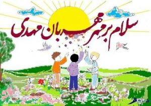

مـــی ایـــــــــد از دور مــردی ســــواره

بـــرمــرکب عشـــق چــــون ماهپــــاره

والشمــس رویـش واللــیــــل مـــویـش

گلـــها هــمه مســــت از رنگ و بویـش

عـمــــامـــه بر سر مثــل پیـمبـــــر (ص)

در بـازوانــش نـیروی حیــــــــــــــــدر(ع)

ازپــای تــاسـر در شـور و شیــــن است

بــرق نگـاهــش مثل حســــین(ع) است

می‌ایــد از دور خوشــــبو تر از یـــــاس

در چشــــم وابرو مـانـند عبــــــاس (ع)

القــصـه ایــن مــرد امیـد دلهاســـــــــت

ای گل گل‌ها سلام

مهدی زهرا سلام

آقای مهربونم

دردو بلات به جونم

مکه ای، کربلایی

نمیدونم کجایی

اما تا زنده هستم

منتظرت نشستم

دوستت دارم همیشه

دلم برات تنگ میشه

*****

حالا که با هم جمع شدیم

پروانه و شمع شدیم

دستامونو بالا کنیم

رو به سوی خدا کنیم

بگیم خدای مهربون

مهدی مارو برسون
