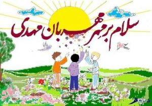

مادرم می‌گوید

یک نفر در راه است

از صدای پایش

دل من آگاه است

وقتی او می‌آید

قاصدک می‌خندد

راه‌های غم را

بر همه می‌بندد

ابر‌ها می‌بارد

چشمه‌ها می‌جوشد

هر درختی در باغ

رخت نو می‌پوشد

مادرم می‌گوید

روی ماهش زیباست

گر چه از او دوریم

او همیشه با ماست

دست می‌زنند همه

با شادی و همهمه

که آمده به دنیا

تنها گل فاطمه (س)

او پسر عسکری

بر همه‌ی ما ولی

او آخرین امام و

او جانشین نبی(ص)

اکنون شده او پنهان

با دعای شیعیان

ظهور کند به جهان

رهبر مستضعفان

سیما شمال نصب

یازده امام معصوم

شهید شدن چه مظلوم

ولی به امر خدا

امام آخر ما

از چشم مردم بد

غایب شد و نیامد

هزار و چندین ساله

شیعه در انتظاره

بالاخره یه روزی

میشه وقت پیروزی

مهدی ظهور می‌کنه

دشمن و دور می‌کنه

جهان می‌شه پر ا زگل

نرگس و یاس و سنبل

ما بچه‌های شیعه

دعا کنیم همیشه

با هم بگیم خدایا

بیار امام ما را
