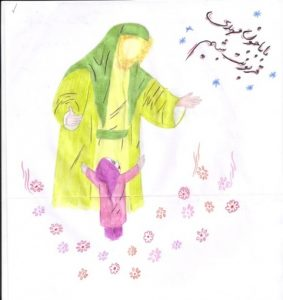

آقای خوبم

ای مهربونم

دوستت دارم من

تا پای جونم

عشق منی تو

روح منی تو

جان منی تو

بت شکنی تو

کی میشه آقا

تو را ببینم

به دستت آقا

کامل شه دینم

قول میدم آقا

نماز بخونم

دوست داری آقا

اینو میدونم

قول میدم آقا

تا درس بخونم

خوشحال میشی تو

اینو میدونم

دوست دارم آقا

قرآن بخونم

راضی میشی تو

اینو میدونم

دوست دارم آقا

تا خوب باشم من

یارت میشم من

اینو میدونم

خورشید عالم

از پشت ابرا

کی میای آقا

ای گل زهرا

کنار کعبه

ندا میدی تو

مردم دنیا

نجات میدی تو

می‌خوام ز الله

خدای دانا

تا زود بیاره

ظهورت آقا

با ظهور تو

بارون ایمان

بر دل‌های ما

می‌باره آقا

مردم دنیا

عاشق میشند و

نعمتای حق

بر ما می‌باره

نام خدا و

قرآن و اسلام

زنده به دستت

می‌شن دوباره

آدمهای بد

از بین میرند و

دنیا چه زیبا

میشه دوباره
