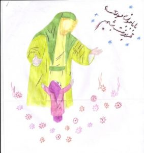

دوباره شور و خنده

به باغ خانه دادی

رسیده جشن شادی

تولدت مبارک

دوباره کوچه‌ها شد

نظافت و چراغان

رسیده ماه شعبان

تولدت مبارک

رسیده بوی نرگس

به کوچه‌های روشن

گرفته قلب دشمن

تولدت مبارک

بگو بگو ندارم

نه غصه و نه دردی

رسیده ماه مهدی (عج)

تولدت مبارک

مهدی وحیدی صدر

*

بچه‌های نازنین

باید اینو بدونید

تا که عقب نمونید

حضرت صاحب الزمان

عزیز ما شیعیان

کمک می‌خواد بچه‌ها

باید آماده باشید

که یار آقا باشید

یار امام زمان

کارهای خوب میکنه

پیش همه عزیزه

بله عزیزان من

باید که بیدار بشیم

به نزد آقا بریم

دلامونو پاک کنیم

دنیا رو آباد کنیم
