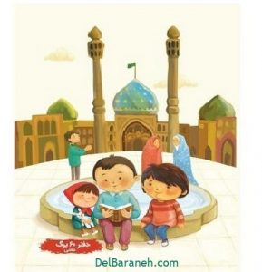

مولودی کودکانه نیمه شعبان

تو یک گل معطری یا مهدی یا مهدی

از همه گل‌ها بهتری یا مهدی یا مهدی

تو گل خوب نرگسی یا مهدی یا مهدی

خوشبو تری از اطلسی یا مهدی یا مهدی

امام باغ و شبنمی یا مهدی یا مهدی

برای من تو همدمی یا مهدی یا مهدی

تویی تو یار و یاورم یا مهدی یا مهدی

دستی بکش روی سرم یا مهدی یا مهدی

یا مهدی یا مهدی یا مهدی یا مهدی

بهار

وقتی که تو بیایی

پروانه می‌شود شاد

خوشحال می‌شود باز

از دیدن تو شمشاد

وقتی که تو بیایی

پر می‌زنند با هم

یک عالمه کبوتر

بر دشت سبز و خرم

وقتی که تو بیایی

با خود می‌آوری گل

همراه تو می‌آیند

گنجشک و سار و بلبل

وقتی که تو بیایی

با خود شکوفه داری

در هر کجا که باشی

زیبایی و بهاری
