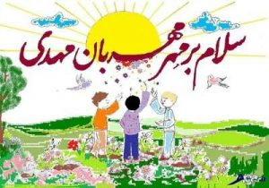

مانند خورشید در پشت ابری

هم باشهامت هم کوه صبری

هم پاک و زیبا هم مهربانی

یعنی امام و صاحب زمانی

هر روز و هر شب در یاد مایی

هم با محبت هم با دعایی

آن چهره ات را می­دیدم ای کاش

مهدی(عج)خوبم در قلب من باش

*

سلام سلام بچه‌ها

سلام سلام غنچه‌ها

روی زمین زیبا

یه گوشه ای همین جا

امام آخر ما

آقا و سرور ما

مهدی صاحب زمان

رهبر کل جهان

مارو نگاه می‌کنه

همش دعا می‌کنه

او صاحبِ زمونه

اما چرا پنهونه

چون بیشتر آدم‌ها

غافل از یادخدا

با کارهای زشتشون

شدند اسیر شیطون

آقا امام زمان

یار همه شیعیان

وقتی که زشتی رو دید

ازدست آنها رنجید

گفت که هنوز یار ندارم

عاشق وغم خوار ندارم

بچه‌ها بیدار بشیم

باهم دیگه یار بشیم

با هم بگیم حرف خوب

انجام بدیم کار خوب

با هم بخونیم دعا

همه بخواهیم از خدا

آید امام غایب

در انتظار اویم

در یاد و فکر ماهست

من بی قرار اویم

جانم فدای مهدی

آن وارث پیمبر

در پنج سالگی شد

ایشان امام و رهبر
