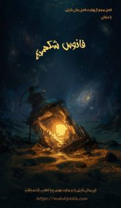

قسمت اول از چهارده قسمت فصل اول افسانه تخیلی

افسانه‌ی فانوس شکسته

از زبان دریانوش، پری نگهبان خورشید‌های خاموش

می‌گویند در دل اعماق اقیانوس‌های کیهانی، فانوس‌هایی هست که اگر از شعله‌ی خورشید جاودان برافروخته نشوند، نوری ندارند که ظلمتِ اعماق را پس بزنند. ما، پریان نگهبان، حافظان این فانوس‌ها هستیم؛ فانوس‌هایی که افسانه‌وار، مسیر را به جویندگان حقیقت نشان می‌دهند.و من، این را از پری‌ای آموختم… پری‌ای از نژاد نخل و نمک؛ نه از ساحل‌های معمولی، که از کرانه‌های آسمان-دریا.

نامش نَرگسا بود. نَرگسا…پری‌ای با قلبی از اذکار مه‌آلود، که همیشه با باله‌های نیایش در دل جریان‌ها شنا می‌کرد. دیده بودمش بار‌ها، آن‌گاه که در معبد‌های آبیِ مرجان‌های شوق، اشک به خورشیدِ گمشده تقدیم می‌کرد. با هر موجی، زمزمه‌اش شنیده می‌شد:«أینَ الطالِبُ بِدَمِ المَقتولِ بِکَربَلا؟» اما روزی، صدایی از فراسوی دریا‌ها آمد؛ از «سرزمین بی‌نقشه»، جایی در دل مه‌هایی سرگردان.صدای کسی که خود را فرستاده‌ی نهان می‌نامید؛ صدایی با واژگان فریبنده، که گویی یقین از اعماقش می‌چکید.نَرگسا… آرام آرام فانوسش را از ما گرفت و به سوی آن صدا شنا کرد. چشمانش می‌درخشید؛ گویی حقیقتی گمشده را یافته بود.اما من…من در شعاع آن صدا، سایه‌ای دیدم. نه از جنس نگهبانان خورشید، نه از خاندان صدف‌دارانِ نور.گفتمش:«نَرگسا، آن‌که بی‌اذن خورشید سخن گوید، صدای حقیقت نیست. فانوست را به او مسپار.» گفت:«دل، مرا می‌خوانَد.» آه دل…دل اگر از نورِ عقل تغذیه نکند، دریا را گم می‌کند؛ به گرداب می‌رسد، نه به ساحل.

نَرگسا رفت. به جای لوح‌های نورانی، کتاب‌هایی را گشود که مرکبشان از مه بود، نه از مهر. رویا‌های پریانِ سرگردان را شنید و آن را نشانه دانست. اما چیزی را نمی‌دید…تأییدِ خورشیدِ شناخته‌شده را نمی‌دید.آینه‌های دریا، پاسخ سکوتش را ندادند. چرا فرستاده‌ای از جنس نور، باید در تاریکیِ بی‌نامی، مدعی پیام باشد؟ چرا صدای نجات، باید از دهان کسی برآید که هیچ آیینه‌ای او را نشان نمی‌دهد؟ ماهِیانِ نگهبان، او را هشدار دادند. اما دل نَرگسا اسیر در طوفانی بود که گمان حقیقت داشت.تا آن شبِ یخ‌زده…در سکوتِ سردِ بهمنِ دریایی، نَرگسا در حبابِ تنهایی‌اش نجوا کرد:«می‌ترسم… فانوسم را به کسی سپرده باشم که به خورشید راهی ندارد…» و همان شب، فانوسش شکست.نه از تردید، که از روشنایی حقیقی‌ای که از دل مه‌ها بیرون زد و ادعای آن مرد را به شب پیوست.آن شب، نَرگسا بازگشت…چشمانش غبار گرفته بود، اما قلبش از شعاع خورشید پر شد.ما، پریان نگهبان، دوباره فانوسش را تعمیر کردیم. این‌بار با شعله‌ای از آفتابِ حقیقی، نه از سراب‌های شعله‌نما.او آموخته بود که وصایت، نه نسب است، نه ادعا؛ عهدی‌ست که باید مُهر خورشید داشته باشد.و هیچ‌کس، هیچ‌کس، بی‌اذن خورشید، حق ندارد فانوس به دست گیرد و ندای نجات سر دهد.نَرگسا دیگر تنها یک پری نبود.او شد یکی از ما. یکی از نگهبانان فانوس‌های حقیقی.

۱۲:۴۲
