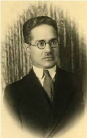
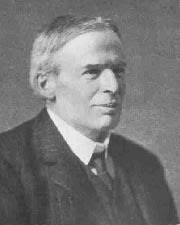

سید احمد کسروی‌، مورخ، زبان شناس و از رجال فکری و فرهنگی معاصر در روز چهارشنبه هشتم مهرماه 1269 ش در هکماوار (قریه حکم آباد) تبریز متولد شد و در پنج سالگی به مکتب رفت و در سیزده سالگی به دلیل درگذشت پدر از تحصیل باز ماند و به کار قالی بافی پرداخت و پس از سه سال عمامه بر سر نهاده و مجدداً به مکتب رفت‌. در این دوران بود که از گوشه و کنار سخنان‌، زمزمه‌هایی بر خلاف بعضی از مطالب اسلامی به گوش می‌رسید که نام او به عنوان یک فرد منحرف بر سر زبان اهالی حکم‌آباد افتاد و از آن پس سید احمد نتوانست در آنجا بماند ناچار به تبریز آمد. در 1285 ش (1324 قمری‌) جنبش مشروطه در ایران دامنه گسترده‌تری یافت و کسروی مشروطه‌خواه شد او با شنیدن نام مشروطه و هدف‌های آن‌، به مشروطه دل بست و در این راه به کوشش‌های سخت برخاست‌. در 1294ش در مدرسه‌آمریکائیان با سمت دبیر عربی استخدام شد در 1295 ش به قفقاز رفت و در تفلیس ماند و با آزادیخواهان آنجا آشنا شد. پس ازبازگشت از قفقاز در تبریز در فرقه دمکرات فعالیت کرد ولی به واسطه‌اختلاف با خیابانی گروه دیگری از دمکرات‌ها را به نام تنقیدیون تشکیل داد و چون نمی‌توانسته در تبریز بماند به تهران آمد و در وزارتخانه‌های فرهنگ و عدلیه مشغول کار شد. کسروی در 1299 ش کارمند استیناف تبریز شد و به این شهر رفت در 1300 ش کارمند استیناف مازندران شد و چهار ماه در آنجا خدمت کرد. پس از آن به دماوند رفت و سپس به تهران آمد و کسروی مدتی رئیس عدلیه زنجان بود و از 1301 به مدت 18 ماه رئیس عدلیه خوزستان بود و با شیخ خزعل و یارانش به مبارزه و مقابله می‌پرداخت‌. کسروی پس از این که به تهران فرا خوانده شد از فرصت بهره گرفت و به دیدن شهرهای عراق رفت. بنا به قول خبر گزاری فارس کسروی در بصره به وسیله خان بهادر وارد فراماسونـری شد. بعد از این که کسروی به تهران آمد داور او را به عدلیه دعوت کرد. کسروی پذیرفت و دادستان تهران شد. کسروی پس از بیرون آمدن از دادگستری به شغل وکالت اشغال داشت‌. وی در سال 1311 ش کتاب «آئین‌» را در رد اروپاییگری انتشار داد و بعد به زبان عربی منتشر ساخت‌، و در اول آذر 1312 مجله پیمان را بنا نهاد و هر پانزده روز یک شماره بیرون داد و از نیمه سال تا هفت سال ادامه داشت و یک شماره در هر ماه منتشر ساخت‌. کسروی در پیمان شروع کرد به نوشتن سخنان دو پهلو، هم می‌خواست به مردم بگوید من پیغمبرم و هم آن را صریح نمی‌گفت‌. کسروی روزنامه پرچم را از سوم بهمن ماه 1320 تا هفتم آذر 1321 ه ش منتشر ساخت و در آن روز تمامی روزنامه‌ها توقیف شد و مجدداً در اسفند 1322 ش مجله هفتگی پرچم را منتشر ساخت‌. کسروی حدود 27 کتاب در موضوعات مختلف تاریخی‌، سیاسی‌، اجتماعی‌، مذهبی نگاشته است‌.

وی در جرگه زبان شناسان و ادیبان جای می‌گیرد. تسلط او به زبان‌های پهلوی، عربی، اسپرانتو، انگلیسی و ترکی استانبولی بر همگان مسلم است و در ادبیات فارسی نیز، صاحب سبک بود. وی به بهانه پالایش زبان و ادب فارسی به حد افراط، استفاده از واژه‌های عربی را مردود می‌شمرد و تا به آنجا پیش رفت که طرح «تغییر خط فارسی به لاتین» را مطرح ساخت. وی در کتاب «زبان پاک» به نقد و عیب جویی از حروف و لغات فارسی پرداخت.

از سوی دیگر کسروی مورخی با متد تاریخ نگاری و تاریخ شناسی خاصه خود بود؛ آثاری چون پیدایش امریکا، تاریخ پانصد ساله خوزستان و … از این دست کتاب‌ها هستند. شاید بتوان کتاب تاریخ مشروطیت کسروی را صرف نظر از کینه توزی‌های وی علیه روحانیت، از کتاب‌های برجسته این دوره بر شمرد.

همچنین نام کسروی در شمار «دین سازان قرن بیستم» نیز آمده است؛ چرا که وی با نظریه پردازی و ادعای اصلاح گری در فرهنگ و دین، مریدانی نیز به دست آورد.

کسروی در سال 1322 شمسی دست به انتشار دو کتاب یکی به نام «در پیرامون اسلام‌» و دیگری به عنوان «شیعه گری‌» زد که در آنها ابتدا نسبت به مذهب شیعه و پیشوایان بزرگ جهان تشیع مانند حضرت امام صادق علیه‌السلام و سپس نسبت به اساس اسلام و آیین پیامبر اسلام حملات شدیدی کرد و از جسارت و اسائه ادب و هتاکی نیز خودداری ننمود. کم‌کم زمزمه‌ی آئینی به نام پاکدینی را آغاز کرد و در واقع بنا به گفته خودش «بنیاد این زمزمه جز “هواو هوس‌» و انگیزه آن جز خودخواهی و مایه‌اش جز نادانی نبوده و اینست که باز به گفته خود او «فیروزی نیافته و کاری از پیش نبرد.» کسروی به جای حملات منطقی اصرار عجیبی در به کار بردن کلمات وعبارات زننده ای که عواطف مذهبی مسلمانان را جریحه دار می‌کرد داشت و نسبت به همه‌ی مقدسات دینی صریحاً ناسزا می‌گفت و هرگز حاضر به بحث و گفتگوی منظم و مودبانه نبود. کسروی علاوه بر مکتب پاکدینی حزبی به نام حزب آزادگان تاسیس کرد که هر کس که وی را متابعت می‌نمود، می‌بایست هر دو مشرب وی را بپذیرد و پیروانش می‌بایست کتباً متابعت خود را اعلام نمایند.

علیرغم تذکر لغزش‌هایش توسط دانشمندان معاصر، وی حاضر به قبول آنها و رفع معایب خود ننمود و حتی‌آن دانشمندانی را که قبل از ادعیه پیامبری با آنان یار غار بود و در مدعای وی هم‌آهنگ نشدند به زشتی از آنان نام برد.

جشن کتابسوزان کسروی بدین ترتیب بود که در شب معینی در سال یاران و هم باوران دور هم جمع می‌شدند هر کس کتابی از مولوی‌، حافظ‌، سنایی‌، عطار یا محمد غزالی‌، رازی‌، ابوسعید ابولخیر، سهروردی و مفاتیح‌الجنان و هر کتاب دعای دیگری همراه می‌آورد آن را در آتش می‌انداختند و این را جشن کتاب سوزان می‌گفتند. کسروی خود در این باره می‌گوید: «چون دیدیم سرچشمه گمراه‌ها و نادانی‌ها کتاب است‌، این است که داستان کتاب سوزان پیش آمده است‌.»

جشن کتاب سوزان در یکم دی ماه‌است و یک دسته سوزانیدن مفاتیح‌الجنان و جامع الدعوات و مانند اینها را دستاویز گرفته و هوچیگری راه انداختند، قرآن هر زمان که دستاویز بدآموزان و گمراه کنندگان گردید. باید از هر راهی قرآن را از دست آنان گرفت گر چه به نابود گردانیدن آن باشد.

کسروی در سال 1322 شمسی با انتشار کتاب «امروز چاره چیست» ضرورت تشکل و انتخاب خط مشی مستقل سیاسی مورد نظرش را خاطرنشان کرد. در این سال است که پیروان او در حزبی بنام «با هماد آزادگان‌» سازمان یافتند. کسروی با بنا کردن حزب با هماد ضمن طرح اصول و مبانی‌اندیشه‌های خود به تبلیغ آئین پاکدامنی می‌پردازد و بنا به نوشته‌هایش هدف وی همساز کردن دین با آئین خرد است.اصول و عقاید پاکدامنی کسروی درکتاب «ور جاوند بنیاد» یا «اصول مقدس» مطرح شده است‌. ناشر افکار کسروی ماهنامه پیمان است‌. کسروی در کتاب «ور جاوند بنیاد» نام پیغمبر را برای فرستاده خداوند غلط می‌داند و برای فرستاده‌ی خداوند لغت «برانگیخته» را پیشنهاد می‌کند و پس از شرح اینکه چگونه بر او وحی شده است چنین می‌گوید: “این بود داستان‌، این بود راز آن که می‌گویم‌: من به این راه با خواست خدا بر خاستم و با راهنمائی‌های او پیش آمدم خدا پرده از جلو بینش من برداشت …. آمدن و رفتن فرشته و پرده برخاستن با خدا همه افسانه است‌.

وی راجع به امام زمان علیه‌السلام چنین است‌: «امام حسن عسگری فرزندی نداشته ….. چگونه تواند بود کسی فرزندی داشته باشد و کسی از آن آگاه نباشد … هزار سال زندگی باورکردنی نیست‌. خدا را چه نیازی بود که کس را هزار سال زنده نگه دارد …» وی نواب اربعه امام قائم عجل الله فرجه را محق نشاخته است‌.

همچنین کسروی منکر آمدن فرشته بود و اساس شیعه را منکر گشته و به امام باقر و امام صادق علیهماالسلام تاخته است. در جای دیگر کسروی گوید: «ما با چهارده کیش به مبارزه برخاسته‌ایم و من از آن پیغمبری که فرشته از آسمان برای او خبر آورد بیزارم اکنون که می‌خواهید نامی برای من عنوان کنید “رهنما» نامید.”

وی در مورد گرفتن وحی توسط پیامبر گوید: «در باره پیامبر که فرشته از آسمان بیاید و پیام آورد چنین چیزی به یک باره دروغ است‌.»

کسروی مربوط بودن واقعه غدیر خم را به تعیین خلیفه و جانشین پیامبر مردود شمرده است‌. و همینطور بحث ولایت بر ائمّه را منکر شد و سخنان درشت بر زبان جاری ساخته است‌. در صفحه 43 کتاب شیعه گری زیارت ائمه و توسّل بدانان را رد نموده است‌. نوشته‌های کسروی مملو از انواع بدگویی‌ها و ناسزا و هتاکی نسبت به مخالفین و نسبت به مقدسات است‌. کسروی به علمای شیعه بدگوئی می‌کند و به خواجه نصیر طوسی اهانت‌ها می‌کند و این مرد را ماجراجو، بی دین و شکم پرست معرفی کرده است‌. کسروی آغاز برانگیختگی خود را از یکم آذر 1312 می‌گیرد و همه ساله در چنین روزی انجمن جشن برپا می‌کند و یاران او هم همین روز را به دستور او «روزبه‌» می‌نامند و انجمن جشن در آن روز اقامه می‌کند و دفترچه یکم آذر را در همین زمینه نوشته است‌. در این دفتر آورده است‌: «مرا اگر نامی می‌باید کلمه “راهنما» را که یاران می‌نویسد برمی‌گزینم‌”

کسروی در کتاب پیرامون ادبیات به شعرای بزرگی مثل حافظ و مولوی و نظامی هم حملات سختی کرده و به فروغی و حکمت و عباس اقبال و ادوارد براون انتقاد کرد و کلمات توهین آمیز بسیار ناپسند برای آنها نوشته است‌. وی درجای دیگر نوشته «شعرهائی که از سعدی و حافظ و خیام و مولوی و ماننداین‌ها بازمانده به یک باره باید نابود شوند و باید همه را به آتش کشید».

زشت ترین اقدام کسروی اسائه ادب به ساحت مقدس ائمّه شیعه بالاخص نسبت به امام محمد باقر و امام جعفر صادق علیهم‌السلام است.

گرچه او از هیچ توهینی نسبت به مقدسات شیعه واهمه‌ای نداشت، اما شکایت مردم مسلمان و متدین در سال‌های 1316-1324 به مقامات مسئول دادگستری نیز هیچ اثری در کاهش اقدامات وی نداشت، این در حالی است که بر اساس قانون اساسی مشروطیت، هرگونه توهین به اسلام و مذهب شیعه جرم محسوب شده و مجرم باید توسط قانون دستگیر و محاکمه شود. اما دادگستری و حکومت معترض کسروی نشدند. پس از فرار رضا خان در شهریور 1320، باز حکومت با کسروی مماشات می‌کرد. مقالات، جزوات، اعتراضات در شهرها – بخصوص در مرکز – بسیار بود، اما حکومت وقت، همان سیاست رضاخان را ادامه می‌دادند. حتی از سوی مراجع و علمای بزرگ نجف، تهران، قم هم اعتراض می‌شد، اما گوش شنوا و فهم و درک سیاسی در کشور نبود.

کسروی از زمانی که عنوان پاکدینی را عرضه داشت هیچ گاه یک تن از بازرگانان و دانشمندان و علمای هم عصر او با وی همراهی نشان نداشتند و دوستان و نویسندگان و اساتید آن ایام که اکثراً قبلاً با وی دوستی نزدیک داشتند، روی از وی برتافتند. به عنوان مثال آقایان‌: عباس اقبال‌آشتیانی‌، ملک‌الشعراء بهار، تقی‌زاده‌، هیئت‌، تربیت‌، ایرانشهر، صدرالاشرف‌، و بهروز را می‌توان نام برد. همگی این افراد به سابقه دوستی با کسروی‌، سکوت کردند و چیزی‌درباره وی نگفتند اما کسروی لب فرو نبست و آن افراد دانشمند را به بدی وزشتی نام برد.

کسروی در اسفند 1324 به خاطر اهانت‌های زیادی بر اسلام و … توسط فدائیان اسلام کشته شد.

وی اصل مهدویت را زیر سؤال برده است. او در دو کتابِ «شیعیگری» و «بهاییگری» در این باره می‌نویسد:

«مهدی گری افسانه است … اگر در ادیان دیگر هم منتظر منجی هستند؛ آنها نیز افسانه است.»، «بیگمان در زمان بنیان گزار اسلام، سخنی از مهدی در میان نبوده و نباید میبود.»، «مهدویت را ایرانیان بین مسلمانان انداخته‌اند.» و «امام حسن عسکری (علیه‌السلام) فرزندی نداشته؛ و چگونه می‌شود کسی فرزندی داشته باشد، و کسی از آن آگاه نباشد.»(1).

کسروی روی بی اطّلاعی گفته است: «بی‌گمان در زمان بنیان گزار اسلام، سخنی از مهدی در میان نبوده و نباید می‌بود.»،

ناصواب گویی سخنان کسروی در عموم مسائل مذهبی به ویژه حوزه مهدویت بر همگان آشکار است و این موضوع از اصیل ترین باور‌های اسلامی – قرآنی است و در سخنان پیامبر خدا موضوع مهدی موعود به روشنی ظاهر است. 45 تن از اصحاب پیامبر خدا روایات مهدی را از آن حضرت نقل کرده اند بدین شمار:

صحابه‌ی راوی احادیث امام مهدی موعود منتظر در منابع اهل تسنن:

1 – «امام امیرالمؤمنین علی بن أبی طالب» (درگذشته 40 ق)، (سنن أبی داود جلد 4، ص 51).

2 – «ابوإمامه باهلی، صدی بن عجلان» (البیان گنجی، ص95)

3- «أبوأیوب أنصاری» (معجم صغیر، طبرانی ج 1، ص 137)

4 – «أبوسعید خدری» (سنن أبی داود ج 4 ص 107 حدیث شماره 4385)

5 – «أبوسلمی راعی» (چوپان شتر‌های) رسول خدا (صلی‌الله‌علیه‌وآله) مقتل الحسین خوارزمی ص95 و به نقل ینابیع المودة 3/160، فرائد السمطین 2/319 حدیث شماره571 و عموم کتب شامل أحادیث مهدی.

6 – «أبوالطفیل عامر بن واثله» (مسند أحمد بن حنبل ج 1، ص 99)

7 – «أبو لیلی» (مناقب خوارزمی، فصل پنجم ص 23ـ 24)

8 – «أبو وائل» (عقد الدرر جمال الدین یوسف دمشقی ص 23 و 38)

9 – «أبوهریره» (صحیح بخاری ج 1، ص 178 و عموم کتب شامل أحادیث مهدی)

10 – «أنس بن مالک» (سنن إبن ماجه ج 2، ص 519)

11 – «تمیم داری» (عرائس ثعلبی ص 186 و به نقل عقد الدرر ص 219)

12 – «ثوبان مولی (غلام آزاد شده) رسول اللّه (صلی الله علیه و آله)» (سنن إبن ماجه ج 2، ص 519)

13 – «جابر بن سمره» (البرهان متّقی هندی، ذیل تنبیهات، تنبیه اوّل)

14 – «جابر بن عبداللّه أنصاری» (مسند أحمد حنبل ج 3، ص 384)

15 – «جابر بن عبداللّه صدفی» (استیعاب قرطبی ج 2 ص111 چاپ ذیل إصابه إبن حجر و معجم کبیر طبرانی ج 22، ص 937)

16 – «امام حسن بن علی» (درگذشته 50 ق)، (ینابیع المودة قندوزی، ص 589)

17 – «امام حسین بن علی» (درگذشته 61 ق)، (البرهان متّقی هندی باب دوّم حدیث 17 و 18)

18 – «سلمان فارسی» (مقتل الحسین خوارزمی ج1، ص 146)

19 – «طلحة بن عبیداللّه» (البرهان، متّقی هندی و المهدی المنتظر، إبن صدیق ص12)

20 – «عباس بن عبدالمطلب» (المهدی المنتظر إبن صدیق، ص12)

21 – «عبدالرحمن بن عوف» (البیان گنجی شافعی، ص96)

22 – «عبداللّه بن حرث (حارث) بن جزء زبیدی» (سنن إبن ماجه ج 2، ص519 و در چاپ دیگر ج 2، ص 270)

23 – «عبداللّه بن عباس» (درگذشته 68 ق)، (فصول المهمّه، إبن صبّاغ مالکی ص 278)

24 – «عبداللّه بن عمر بن خطاب» (درگذشته 74 ق)، (فصول المهمّه، إبن صبّاغ، ص 277 و البرهان، متقی هندی، باب 1 حدیث 2 و باب 6 حدیث 6)

25 – «عبداللّه بن عمرو بن عاص» (البیان، گنجی شافعی، ص92)

26 – «عبداللّه بن مسعود» (فصول المهمة، إبن صبّاغ، ص279)

27 – «عثمان بن أبی العاص» (مسند أحمد حنبل ج 4، ص 216 و 217)

28 – «عثمان بن عفّان» (المهدی المنتظر، صدیق مغربی ص12، و در مقاله فتوائی ــ اداره مجمع فقهی سعودی در مکّه ــ مندرج در آخر البیان گنجی شافعی ص77 چاپ بیروت)

29 – «علقمة بن عبداللّه» (سنن إبن ماجه [بنقل المهدی فی السنة شیرازی ص42] و فصول المهمة، إبن صبّاغ مالکی)

30 – «علیّ الهلالی» (مجمع الزوائد هیثمی ج 9، ص 165)

31 – «عمار بن یاسر» (البرهان باب اول حدیث 10 و باب 4 فصل 2 حدیث شماره 7 و 24)

32 – «عمر بن خطاب» (البرهان باب اول حدیث 38)

33 – «عمران بن حصین» (مسند أحمد بن حنبل ج 4، ص 437)

34 – «عمرو بن عاص» (البرهان باب چهارم فصل 2 حدیث 23)

35 – «عمرو بن مره جهنی» (إبراز الوهم المکنون، أبوالفیض غماری و عرف الوردی ص139 و 390 و المهدی المنتظر إبن صدیق ادریسی ص13)

36 – «عوف بن مالک» (معجم کبیر طبرانی)

37 – «قتادة بن نعمان» (البرهان باب اول حدیث 17 و باب ششم حدیث 10 و 11)

38 – «قرة بن ایاس المزنی» (ینابیع المودة ص 220)

39 – «کعب الأحبار» (عقد الدرر، جمال الدین دمشقی ص 180 و 233 ــ 234 به نقل از الفتن، نعیم بن حماد)

40 – «کعب بن علقمه» (البرهان باب هفتم حدیث 8 ـ 13 ـ 21)

41 – «معاذ بن جبل» (درگذشته 18 ق)، (إبراز الوهم المکنون، أحمد بن محمد بن صدیق، ص 8)

42 – «فاطمة الزهراء بنت رسول اللّه (صلی‌الله‌علیه‌وآله)» (درگذشته 10 ق)، (فرائد السمطین، حموینی)

43 – «أم المؤمنین أم سلمه» (سنن أبی داود ج 4، ص 151)

44 – «أم المؤمنین عایشه» (کتاب الفتن، نعیم بن حماد به نقل عقد الدرر ص 16 ــ 17 و البرهان باب دوم حدیث 21)

45 – «أم حبیبه» (البرهان باب چهارم فصل 2 حدیث 20)

ــــــــــــــــــــــــــــــــــــــــــــــــــ\
1. ذهنیت مستشرقین: 55.
